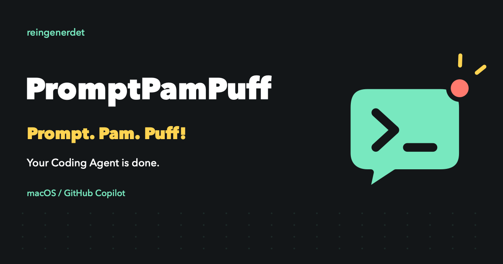

# PromptPamPuff

<picture>
	<source media="(prefers-color-scheme: dark)" srcset="Resources/Brand/Logo-Dark.png">
	
</picture>

**Prompt. Pam. Puff! — Your Coding Agent is done.**

Your agent is working. You don't have to stare at the chat.

PromptPamPuff is a tiny, native macOS menu bar app with a comic wink and a calm, native interior. It watches GitHub Copilot Chat in VS Code and gives a gentle *Puff* — a notification, a soft sound, or both — the moment an answer lands or a follow-up question shows up. Then it gets out of your way again.

This repository hosts **releases and downloads** for PromptPamPuff. Source code lives in a private repository; this is the public home for builds, issues, and installation instructions.

## Contents

- [PromptPamPuff](#promptpampuff)
  - [Contents](#contents)
  - [Features](#features)
  - [Requirements](#requirements)
  - [How to install](#how-to-install)
  - [First launch](#first-launch)
  - [How it works](#how-it-works)
  - [Custom hooks](#custom-hooks)
  - [Languages](#languages)
  - [Privacy](#privacy)
  - [Limitations](#limitations)
  - [Troubleshooting](#troubleshooting)
  - [Uninstall](#uninstall)
  - [Support](#support)
  - [Legal](#legal)

## Features

- Lives quietly in the macOS menu bar — no dock icon, no clutter.
- Reacts to three events, each configurable on its own: **request started**, **answer completed**, **follow-up question asked**.
- Per event: enable/disable, notification on/off, sound on/off, and an optional custom hook script.
- A gentle, original 220 ms "Puff" sound — or pick silence and rely on notifications alone.
- Native look and feel: system font, system colors, standard window chrome. No forced dark mode, no custom skin.
- Fully local: no logs, chats, or telemetry ever leave your Mac.
- German, English, French and Spanish, switchable in-app without a restart.

## Requirements

- macOS 13 (Ventura) or later
- GitHub Copilot Chat in VS Code Stable
- Notifications permission granted to PromptPamPuff (macOS will ask on first use)

## How to install

1. Go to the [Releases](../../releases) page and download the latest `PromptPamPuff.zip`.
2. Unzip it and drag `PromptPamPuff.app` into `/Applications`.
3. Quit any older version and quit the legacy Python watcher, if you still have it running, to avoid duplicate notifications.
4. Launch `PromptPamPuff.app`.

## First launch

The app is signed ad-hoc, not notarized by Apple, so Gatekeeper will likely block the first launch:

1. Right-click (or Control-click) `PromptPamPuff.app` in `/Applications` and choose **Open**.
2. Confirm in the dialog that appears. You only need to do this once.
3. On first start, the Settings window opens automatically. Grant notification permissions when asked.

You can reopen Settings anytime from the speech-bubble icon in the menu bar.

## How it works

PromptPamPuff watches VS Code Stable's own log files under `~/Library/Application Support/Code/logs` (including multiple windows) and reacts to exactly three signals:

| Event | Trigger |
| --- | --- |
| Request started | A new `VoiceProgress ... loop request=` entry, meaning the agent picked up a new request |
| Answer completed | A `ToolCallingLoop ... shouldContinue=false` entry |
| Follow-up question asked | A `vscode_askQuestions` entry inside a `VoiceProgress ... tools=` line |

Existing log entries are skipped on launch and resume. While monitoring is paused, no new events are processed — but hooks that already started keep running. Use **Test event** in Settings to try the currently enabled actions, hooks included. The speaker button previews only the selected sound, without triggering a notification or hook.

## Custom hooks

Each event can trigger your own script under Automation. Supported: `.sh` / `.zsh` (via `/bin/zsh`), `.applescript` / `.scpt` (via `/usr/bin/osascript`), and other executables. Paths are passed as arguments, never interpolated into a shell command, and you'll see a confirmation prompt before a hook is enabled.

Hooks receive these environment variables:

- `COPILOT_EVENT` — `started`, `answer`, or `question`
- `COPILOT_EVENT_TITLE` — human-readable event name
- `COPILOT_SUMMARY` — last recognized action, up to five words

Hooks run with your user privileges, one after another, with a 30-second timeout per directly launched process, and at most eight calls running or queued at once. Any background processes a script spawns are your own responsibility to manage. Failures show up in Settings; standard output and error from scripts are discarded. Because hooks and log access are unrestricted, the app is not sandboxed.

## Languages

German, English, French and Spanish are selectable directly in the app. The default is the first supported system language, falling back to English. Menus, notifications, action descriptions, confirmation prompts, and error messages switch instantly, without a restart. Native macOS dialogs and system errors still follow macOS's own language.

## Privacy

Everything happens on your Mac. PromptPamPuff never sends logs, chat content, or any other data to an external service.

## Limitations

The log signals are not an official Copilot API and may change with extension updates. Questions embedded in normal answer text, tool approvals, cancellations, and errors are not their own events — follow-up detection needs a matching `VoiceProgress` entry, and some voice modes may produce different logs. Multiple simultaneous chats in the same window can mix up which action is attributed to the "answer completed" signal, since the stop signal carries no chat ID. The action description is not proof that a tool actually succeeded.

## Troubleshooting

- **No notifications appear** — check System Settings → Notifications → PromptPamPuff, and make sure Focus mode isn't blocking it.
- **Duplicate notifications** — quit any other running instance (including the old Python watcher) before starting a new one.
- **App won't open** — see [First launch](#first-launch); it needs a one-time Gatekeeper override since it isn't notarized.
- **Notifications stopped after an update** — the bundle ID changed to `de.reingenerdet.promptpampuff`, so macOS may ask for permission again. Quit the old instance before launching the new one.

Settings are stored at `~/Library/Application Support/PromptPamPuff/preferences.json`. On first launch, existing settings are migrated from `~/Library/Application Support/Copilot Watch/preferences.json` if present, without touching the original file.

## Uninstall

Quit PromptPamPuff, delete `PromptPamPuff.app` from `/Applications`, and optionally remove `~/Library/Application Support/PromptPamPuff/`.

	

## Support

Found a bug or have a feature request? Open an [issue](../../issues) in this repository.

## Legal

PromptPamPuff is an independent product by **reingenerdet** and is not endorsed by or affiliated with GitHub, Microsoft, or Apple. The app is proprietary software distributed directly; source code is not published under an open-source license. This repository provides releases and support only.
